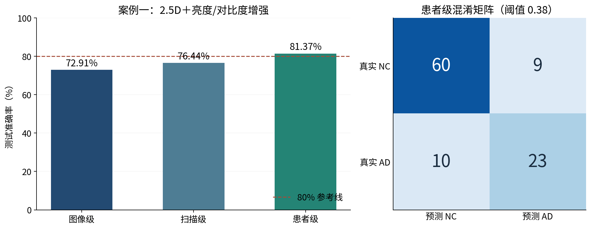
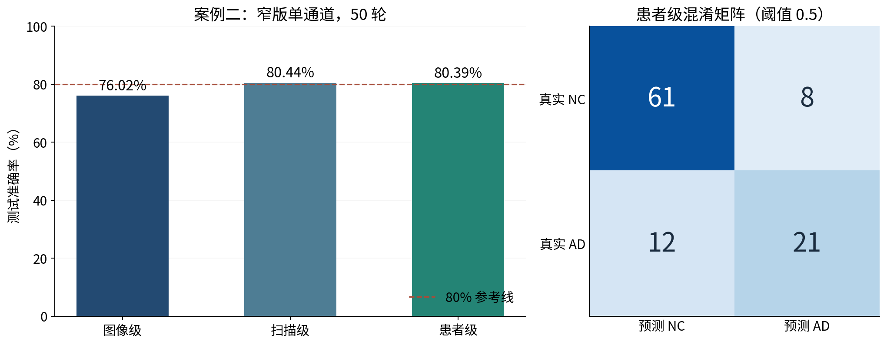
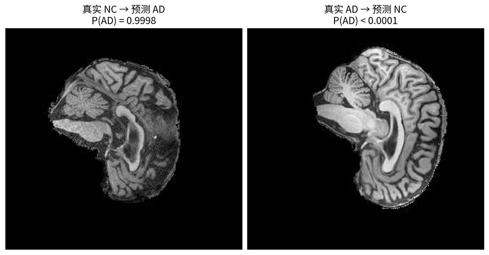
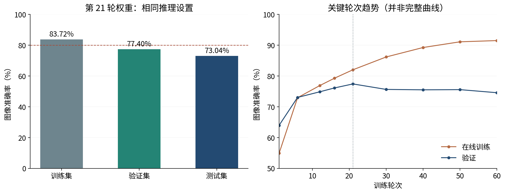

# 基于 ConvNeXt 的 ADNI 脑部 MRI 分类探索

**COMP3710 Pattern Recognition 项目报告（中文版）**  
作者：Jinqiao Han　｜　日期：2026 年 10 月 27 日

## 报告概述

本项目利用 ADNI MRI 切片区分阿尔茨海默症（AD）与认知正常（CN，代码中记为 NC）。针对该深度学习实验，我依次尝试延长训练、调整学习率与权重衰减、改变输入方式、数据增强、正则化和缩小模型，尽管最终并未达到准确率为80%的要求，但我依旧分析了这些方法的作用，并通过这个项目，且是学到了很多有关有用、实用的知识和项目方法。

**本报告将图像级验证准确率为 77.40% 的窄版单通道 ConvNeXt 作为最终版本。该版本的图像级测试准确率为 73.04%，没有达到 80% 的课程目标。**有两个实验的患者级测试准确率分别达到 81.37% 和 80.39%，体现了探索中的部分成果，但不能替代图像级达标。本人在实验过程中，得到的最高图像级测试准确率为76.02%，但本人并未将其作为最终版本。

报告选择三个“未达到图像级目标”的实验作为失败案例，而不是把它们视为毫无价值。重点是说明每次为什么改变、希望解决什么问题、实际观察到什么，以及由此学到什么。不同阶段的数据划分、训练轮数和模型规模有所变化，因此以下比较用于呈现探索过程，不作为严格的单因素因果结论。

## 本文使用的方法总览（术语说明）
为方便查阅，特将本文涉及的方法和术语说明：
- **患者隔离与分层划分**：按患者分组并按 AD/NC 类别分层划分数据集，确保同一患者的所有切片不跨集合，避免数据泄漏，使任务接近识别未见过的患者。
- **单通道图像处理**：统一缩放至 224×224，像素映射到 [0,1] 后以均值 0.5、标准差 0.5 归一化至约 [-1,1] 区间。
- **数据增强（翻转/平移/2.5D/jitter）**：引入位置与亮度变化（含 2.5D 三通道输入、亮度/对比度 jitter），让模型减少对固定坐标或灰度风格的依赖，提升鲁棒性。
- **从零训练（窄版 ConvNeXt）**：不使用预训练权重，将通道宽度缩小为 32/64/128/256，保留卷积与残差结构，自主学习特征。
- **AdamW**：解耦权重衰减与梯度更新，自适应调整参数更新幅度的同时独立限制权重增长，稳定泛化。
- **Warm-up（预热）**：训练初期将学习率从极小值逐步提升至目标值，防止初始不稳定梯度导致参数震荡或梯度爆炸。
- **Cosine decay（余弦退火）**：中后期将学习率按余弦曲线平滑衰减，使模型在后期以小步长精细微调。
- **Label smoothing（标签平滑）**：将硬标签软化为概率分布（如 0.95/0.05），防止模型对训练标签过度自信，减弱过拟合。
- **DropPath（随机深度）**：训练时随机跳过残差分支，迫使网络学习冗余特征，减少对特定计算路径的依赖（不同于分类头 Dropout）。
- **分类头 Dropout**：在分类层随机置零神经元，作为正则化手段防止过拟合。
- **EMA（指数移动平均）**：对历史模型参数做指数衰减平均（如 decay=0.999），维护一套“影子权重”，平滑训练过程中的权重震荡。
- **AMP 混合精度与梯度缩放**：使用半精度计算前向/反向，配合梯度缩放防止下溢，降低显存成本并加速训练。
- **平衡准确率与多层级评估**：以平衡准确率（两类召回率均值）为选模主指标以避免类别偏向，结合宏F1、ROC-AUC，并按切片、扫描、患者层级及不同阈值（如 0.38/0.5）进行综合评估。
**阅读结构：**正文第一部分分析两个患者级超过 80% 的案例；第二部分解释最终版本的数据与训练方法；第三部分分析最终结果和理论改进方向。附录提供两个案例的结果图、真实 MRI 误判切片，以及最终版本的训练趋势图。正文按三部分组织；Markdown 本身没有固定纸张分页，转入 Word 时可按下方分页标记排版。

<!-- 建议分页：封面结束；正文第 1 页开始 -->

## 一、探索过程与两个取得部分成果的失败案例

最初的 feasibility 计划把患者级准确率和 AUROC 不低于 0.80 作为目标。但我从ED上得知，课程的 80% 测试准确率应按切片计算，故依照此要求进对最终目标进行了个更改。早期我使用在 ImageNet 预训练的ConvNeXt-Tiny模型，取得过 86.04% 图像级测试准确率，这说明ConvNeXt具备实现课程目标的能力。本报告的三个案例与最终版本均从零训练，不用该探索成绩替代最终结果。

### 1.1 起点：增加训练量没有自动改善泛化

原始 ConvNeXt-Tiny 约有 2,782 万参数。采用 AdamW、学习率 0.001、WD 0.0001 训练 8 轮，最低验证损失出现在第 2 轮，对应验证准确率 73.15%。延长至 30 轮后，该选模结果未变，而最终训练准确率升至 98.18%。参数量相近的普通 CNN 在八轮实验中取得 75.88% 的选中模型验证准确率。这使我认识到：更复杂的结构和更多训练轮数，不一定更适合当前数据。

其他探索也没有带来稳定突破：完整 Tiny 将固定 LR 降至 0.0003 后，选中模型验证准确率为 73.10%；两轮 warm-up 加 cosine 的版本为 72.38%；在后述 2.5D 增强配置上加入分类头 Dropout(p=0.2)，则由 75.74% 降为 73.66%。这些记录促使我把关注点转向输入信息与网络容量，而不是只重复调整一个数字。

### 1.2 失败案例一：2.5D 输入与亮度、对比度增强

我将“同一灰度切片复制三遍”改为“前一张、当前张、后一张切片组成三个通道”，希望补充局部空间信息；再仅在训练时加入各约 ±10% 的亮度、对比度变化，使模型减少对固定灰度风格的依赖。模型仍为完整 Tiny，学习率 0.001、WD 0.0001、8 轮，按最低验证损失选中第 4 轮。患者按 70%/15%/15% 划分，训练、验证、测试分别有 21,700、4,320、4,500 张切片。

2.5D 的验证图像准确率由原始 73.15% 升至 74.19%，加入增强后达到 75.74%。测试图像准确率却只有 **72.91%**。在验证集选定患者阈值 0.38 后，患者测试准确率达到 **81.37%（83/102）**，AUROC 为 0.8555；图像和扫描阈值仍为 0.5。

**图 1 的患者混淆矩阵显示：60/69 名 NC、23/33 名 AD 被正确识别，仍漏掉 10 名 AD 患者。**聚合概率和调整患者阈值可以改善患者层面的判断，却不会修正每张切片的分类。相邻切片提供的信息也可能高度重复，而亮度变化没有增加新的患者或疾病特征。因此，这是输入设计和患者识别上的部分成功，但仍未完成图像级目标。

### 1.3 失败案例二：窄版单通道与 50 轮训练

随后，我将 ConvNeXt 通道宽度缩小为 32/64/128/256，并使用单张灰度切片作为输入，参数降至 **3,178,018**。缩小网络希望降低模型记忆训练样本的能力；单通道则避免重复输入同一灰度信息。参数减少约 88.6% 主要来自网络变窄，而不是三通道改成一通道。

该案例沿用 70%/15%/15% 患者划分、轻度增强与随机深度，使用 LR 0.001、WD 0、batch size 64，训练 50 轮。从距最高验证图像准确率不超过 0.005 的模型中选择验证损失最低者，最终选中第 22 轮。验证图像准确率为 75.90%，测试图像准确率为 **76.02%**；患者测试准确率达到 **80.39%（82/102）**，AUROC 为 0.9007，但 AD recall 只有 **63.64%（21/33）**。

**图 2 显示，患者总体准确率超过 80%，仍有 12 名 AD 被判为 NC；图 3 进一步展示了该模型两张高置信度切片误判。**训练至第 50 轮时，训练准确率已达 98.12%，验证准确率却为 74.47%。这说明缩小模型没有消除过拟合；单张切片也可能缺少充分的疾病信息，不能把患者级标签在每张切片上都视为同样容易识别。

<!-- 建议分页：正文第 2 页开始 -->

## 二、失败案例三与最终版本：验证图像准确率 77.40%

### 2.1 数据划分与输入处理

最终版本汇总课程原有 train/test 文件夹，通过 metadata 将数字文件名对应到扫描和患者，再按患者分组、按 AD/NC 类别分层，以 seed 42 重新划分。**这不是直接沿用课程原始测试文件夹，也不是按切片随机分配。**同一患者的不同扫描及全部切片留在同一集合；程序检查三组患者互不重叠。比例指患者比例，切片数量不必严格符合相同比例。

| 集合 | 患者数及占比 | 扫描数 | 切片数 |
|---|---:|---:|---:|
| 训练 | 476（70%） | 1,040 | 20,800 |
| 验证 | 68（10%） | 154 | 3,080 |
| 测试 | 136（20%） | 332 | 6,640 |
| 总计 | 680 | 1,526 | 30,520 |

患者隔离用于避免同一人的相似切片同时进入训练和评估，一方面能够避免数据泄露（20,800 张训练切片仅来自 476 名患者。来自于同一人的不同照片，拍摄的是同一张大脑，因此具有相似性），一方面确保培养模型识别未见过的人的能力；它本身不会让准确率提高，也不保证训练与验证表现相近。最终版本仍输入单通道图像，统一缩放至 224×224，像素映射到 [0,1] 后以均值 0.5、标准差 0.5 归一化，即变为约 [-1,1]。

### 2.2 模型与训练方法：原理和预期作用

最终网络为从零训练的窄版 ConvNeXt，宽度 32/64/128/256、各阶段块数 3/3/9/3，共 3,178,018 个可训练参数。它保留卷积与残差结构，使用 7×7 深度卷积、通道混合、LayerNorm 和全局平均池化，不是使用自注意力的 Transformer。[1]

| 方法与实际数值 | 原理及应该起到的作用 |
|---|---|
| 训练集随机水平翻转 p=0.5；水平、垂直平移最多约 5%；不旋转 | 让同一图像呈现轻微位置变化，减少对固定坐标的依赖。验证和测试仅采用确定性缩放、归一化。 |
| AdamW：LR=0.0003，WD=0.05 | 自适应调整参数更新幅度，同时把权重衰减与梯度更新分开，限制权重增长。[2] 此代码将全部可训练参数交给优化器。 |
| 60 轮 cosine decay | 学习率随训练逐步降低，使后期更新更细；本版没有 warm-up。 |
| Label smoothing=0.1 | 对二分类平滑后的目标约为 0.95/0.05，减弱对极端确定输出的鼓励；不保证概率已校准。 |
| DropPath 最大值 0.2 | 训练时随机跳过残差分支，减少对特定计算路径的依赖；评估时关闭。它不是分类头 Dropout。 |
| Batch size=64；AMP 混合精度 | 分批估计梯度；使用混合精度及梯度缩放降低计算和显存成本，主要是效率措施。 |

每轮执行训练后评估验证集，按**验证图像 balanced accuracy**保存最佳权重。它是两类召回率的平均值，用于避免只偏向一个类别。该轮的普通图像 accuracy 同时记录，但不是本版保存模型的主指标。第 21 轮取得最高 balanced accuracy 0.7762，对应图像 accuracy 77.40%，因此选择该轮进行后续评估。

**版本边界：77.40% 版本没有亮度/对比度 jitter，也没有 EMA。**后续加入 jitter 的运行验证图像准确率为 76.92%；另一次 EMA=0.999 的日志最高验证 balanced accuracy 为 76.85%，故没有被采纳。

<!-- 建议分页：正文第 3 页开始 -->

## 三、最终结果、作用有限的原因与改进方向

### 3.1 最终模型取得了什么结果

下表均为所选第 21 轮权重的评估结果；训练集数值来自关闭随机增强和随机深度后的单独推理，而非最后一轮的在线训练准确率。图 4 同时给出了三组表现和训练过程中的关键轮次。

| 指标 | 训练集图像 | 验证集图像 | 测试集图像 |
|---|---:|---:|---:|
| Accuracy | 83.72% | **77.40%** | **73.04%** |
| Balanced accuracy | 83.80% | 77.62% | 73.14% |
| AD recall | 87.67% | 80.42% | 77.28% |
| Macro-F1 | 0.8371 | 0.7738 | 0.7303 |
| ROC-AUC | 0.9243 | 0.8337 | 0.8153 |

验证扫描、患者准确率分别为 80.52%、73.53%；测试扫描、患者准确率分别为 74.10%、72.79%。因此，77.40% 是**验证图像**结果，不是测试结果。测试切片混淆矩阵为 [[2346,1054],[736,2504]]（行是真实 NC/AD，列是预测 NC/AD）：模型错判 1,054 张 NC、漏掉 736 张 AD。训练使用 A100-SXM4-40GB；该次测试日志记录约 0.59 ms/切片及 599.9 MB 峰值显存，测量口径不直接等同于其他脚本的纯前向速度。

### 3.2 为什么加入多种方法后，作用仍然有限

**第一，增强增加了样本变化，没有增加独立患者。**平移和翻转有助于位置鲁棒性，却不能补足疾病差异或完整三维结构；在标准化脑图像上，过大的或解剖上不合适的变换反而可能干扰特征。模型也可能学习患者特有的外观，而不是稳定的 AD 特征。

**第二，训练优化与泛化是不同问题。**最终运行的在线训练准确率由第 21 轮 82.00% 升至第 60 轮 91.48%，验证准确率却从 77.40% 降至 74.55%。cosine、WD、label smoothing 和随机深度并不能自动补充缺失的信息；它们改善更新过程或约束拟合，不保证未见患者上的准确率继续上升。现有曲线支持“泛化仍受限”，不能据此认定某种方法普遍无效。

**第三，评估人群较少且可能存在分布差异。**验证集只有 68 名患者，少数难例或扫描风格变化就可能影响大量切片。曾观察到较早时间标记的图片似乎集中于 AD，这提示应检查类别与来源的关联；文件时间不一定是采集时间，目前不能把年份、设备或划分错误当作已证实原因。严格患者隔离与训练、验证有差距可以同时成立。

### 3.3 理论上的下一步优化

优先按切片位置、患者、扫描来源统计错误，核实翻转是否符合实际切面，并尝试脑组织区域的稳健强度归一化。所有数据驱动的统计量仅从训练集估计。目的在于削弱无关的采集差异，而不是通过反复重分测试集获得更高成绩。

训练方面可尝试按患者或扫描均衡抽样，减少多次扫描患者对损失的过度贡献；保留当前窄版作为起点，优先选择接近验证峰值的模型，不把延长至 100 轮当作必然改进。若课程主要考核图像 accuracy，下一轮可预先规定其为主选模指标，balanced accuracy、AD recall 和损失作为补充。EMA 可平滑权重波动，但本项目已有尝试尚未证明收益，不应写成有效结论。

本人在本项目的主要收获，是建立了完整的训练、选模、分层评估与失败分析流程，并理解“训练拟合更好”“患者聚合超过 80%”与“单切片泛化达标”是不同目标。

<!-- 建议分页：正文结束；图像附录第 1 页开始 -->

## 图像附录 A：两个患者级超过 80% 的失败案例

### 图 1　案例一：患者层面的部分成功，不等于单张切片达标

**读图：**左图使用同一次测试的图像、扫描、患者准确率；虚线为 80%。图像和扫描阈值为 0.5，患者阈值为在验证集选择的 0.38。右图是 102 名患者的混淆矩阵，行表示真实类别，列表示预测类别。患者总体准确率 81.37% 的背后，仍有 10/33 名 AD 患者被漏判；患者聚合改善的是决策单位，不能反推每张图像的表现。

### 图 2　案例二：网络缩小后，患者指标仍掩盖部分漏判

**读图：**该模型三种层级均采用阈值 0.5，测试图像准确率为 76.02%，患者准确率为 80.39%。患者矩阵中 NC 正确 61 人、AD 正确 21 人，12 名 AD 被错判为 NC。患者数据中 NC 有 69 人、AD 有 33 人，因此需要同时查看 AD recall，而不能只看总准确率。

<!-- 建议分页：图像附录第 2 页开始 -->

## 图像附录 B：真实误判切片与最终版本趋势

### 图 3　案例二的两张高置信度切片误判

左：患者 023_S_1190，切片 1251421_104.jpeg，真实 NC，预测 AD，P(AD)=0.9998。右：患者 127_S_5028，切片 375181_98.jpeg，真实 AD，预测 NC，P(AD)<0.0001。图片与概率沿用前版报告核对过的切片记录，展示时没有改变图像灰度。**这是切片级误判示例，不代表这两人的患者级聚合结果也一定错误。**高置信度不能等同于正确；仅凭这些图片，不能断言具体脑区或萎缩现象导致了错误。

### 图 4　最终版本：有学习进展，但后期收益不足

左：同一第 21 轮权重对训练、验证、测试集的确定性推理。右：训练日志中第 1、6、12、16、21、30、40、50、60 轮的准确率，以连线展示阶段趋势，**并非完整逐轮曲线**；在线训练开启增强与随机深度。后期训练表现继续改善，而验证未保持提升，说明继续拟合训练集的收益没有充分转化为泛化能力。

### 资料来源与 AI 使用说明

[1] Liu, Z. et al. A ConvNet for the 2020s. CVPR, 2022. https://openaccess.thecvf.com/content/CVPR2022/html/Liu_A_ConvNet_for_the_2020s_CVPR_2022_paper.html

[2] Loshchilov, I. & Hutter, F. Decoupled Weight Decay Regularization. ICLR, 2019. https://arxiv.org/abs/1711.05101

实验依据：项目 README、Feasibility of ConvNeXt、保存的训练日志和预测记录、前版报告及各阶段代码。病例图源于课程 ADNI 数据。本报告保留不同阶段的设置差异，所有准确率均标明集合和评估层级。

ChatGPT用于代码建议、调试、实验思路整理与报告辅助写作。实验结果来自实际运行记录；尚未实施的优化以建议形式呈现。作者负责最终核对与提交。
