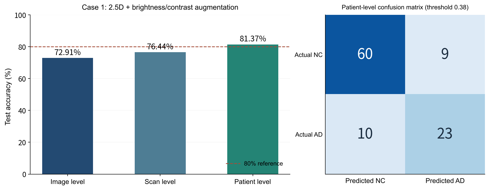
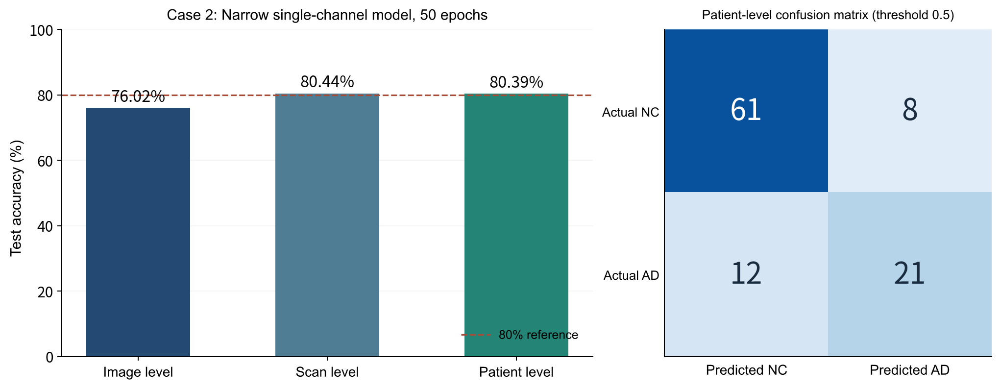
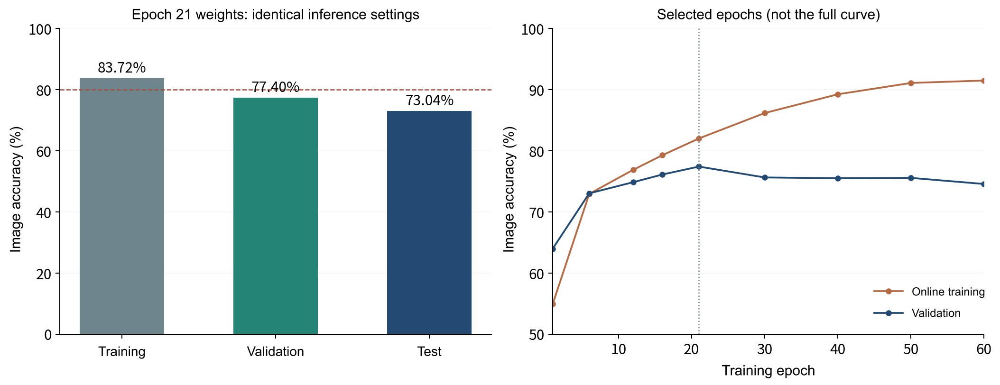

# Exploring ADNI Brain MRI Classification with ConvNeXt
 
Author: Jinqiao Han　｜　Date: 27 October 2026

## Report Overview

This project uses ADNI MRI slices to distinguish Alzheimer's disease (AD) from cognitively normal controls (CN, denoted as NC in the code). During this deep learning experiment, I successively tried extending training, adjusting the learning rate and weight decay, changing the input representation, applying data augmentation and regularization, and reducing the model size. Although the final model did not meet the 80% accuracy requirement, I still analyzed the effects of these methods and learned a great deal of useful, practical knowledge and project methodology through this work.

**This report adopts the narrow, single-channel ConvNeXt with 77.40% image-level validation accuracy as the final version. Its image-level test accuracy is 73.04%, below the course target of 80%.** Two experiments achieved patient-level test accuracies of 81.37% and 80.39%, respectively, representing partial achievements during the exploration, but these cannot substitute for meeting the image-level target. The highest image-level test accuracy I obtained during the experiments was 76.02%, but I did not adopt that model as the final version.

The report selects three experiments that did not meet the image-level target as failure cases, rather than treating them as worthless. The focus is on why each change was made, what problem it was intended to address, what was actually observed, and what was learned. Data splits, training durations, and model sizes varied across stages, so the comparisons below describe the exploratory process rather than establish strict, single-factor causal conclusions.

## Overview of the Methods Used in This Report (Terminology)

For ease of reference, the methods and terminology used in this report are explained below:

- **Patient isolation and stratified splitting**: Group the data by patient and stratify the split by AD/NC class, ensuring that all slices from a patient remain in the same subset. This avoids data leakage and makes the task closer to recognizing previously unseen patients.
- **Single-channel image processing**: Resize all images to 224×224, map pixel values to [0,1], and normalize them with a mean of 0.5 and a standard deviation of 0.5, producing values approximately within [-1,1].
- **Data augmentation (flipping/translation/2.5D/jitter)**: Introduce variations in position and brightness, including 2.5D three-channel inputs and brightness/contrast jitter, to reduce the model's reliance on fixed coordinates or grayscale appearance and improve robustness.
- **Training from scratch (narrow ConvNeXt)**: Use no pretrained weights, reduce the channel widths to 32/64/128/256, and retain convolutional and residual structures so that the model learns features from scratch.
- **AdamW**: Decouple weight decay from gradient updates, adaptively adjust the magnitude of parameter updates, and independently constrain weight growth to support stable generalization.
- **Warm-up**: Gradually increase the learning rate from a very small value to the target value at the start of training, preventing unstable initial gradients from causing parameter oscillations or exploding gradients.
- **Cosine decay (cosine annealing)**: Smoothly reduce the learning rate along a cosine curve during the middle and later stages of training, allowing finer parameter updates with smaller steps toward the end.
- **Label smoothing**: Soften hard labels into probability distributions, such as 0.95/0.05, to prevent excessive confidence in training labels and reduce overfitting.
- **DropPath (stochastic depth)**: Randomly skip residual branches during training, encouraging the network to learn redundant features and reducing its dependence on particular computational paths. This differs from classifier-head Dropout.
- **Classifier-head Dropout**: Randomly set neurons to zero in the classification layer as a regularization measure against overfitting.
- **EMA (exponential moving average)**: Maintain a set of "shadow weights" by taking an exponentially decaying average of historical model parameters, for example with decay=0.999, to smooth weight fluctuations during training.
- **AMP mixed precision and gradient scaling**: Use half-precision computations for the forward and backward passes, together with gradient scaling to prevent underflow, reducing GPU memory use and accelerating training.
- **Balanced accuracy and multi-level evaluation**: Use balanced accuracy, the mean of the two class recalls, as the main model-selection metric to avoid class bias. Combine it with macro-F1 and ROC-AUC, and evaluate at slice, scan, and patient levels using different thresholds, such as 0.38/0.5.

**Reading guide:** Part I analyzes two cases with patient-level accuracy above 80%; Part II explains the data and training methods of the final version; and Part III analyzes the final results and potential improvements. The appendices provide result figures for the two cases, actual misclassified MRI slices, and training trends for the final version. The main text is organized into three parts. Markdown itself has no fixed paper pagination; when transferring the report to Word, the suggested page-break markers below can guide the layout.

## I. Exploration and Two Failure Cases with Partial Achievements

The initial feasibility plan set targets of at least 0.80 for patient-level accuracy and AUROC. However, I learned from ED that the course's 80% test accuracy requirement should be measured at the slice level, so I revised the final target accordingly. In an early experiment, I used a ConvNeXt-Tiny model pretrained on ImageNet and achieved 86.04% image-level test accuracy, showing that ConvNeXt has the capacity to meet the course target. The three cases and the final version discussed in this report were all trained from scratch; that exploratory result is not used in place of the final results.

### 1.1 Starting Point: More Training Did Not Automatically Improve Generalization

The original ConvNeXt-Tiny had approximately 27.82 million parameters. With AdamW, a learning rate of 0.001, and WD of 0.0001 over 8 epochs, the lowest validation loss occurred at epoch 2, corresponding to a validation accuracy of 73.15%. Extending training to 30 epochs did not change the selected checkpoint, while the final training accuracy rose to 98.18%. An ordinary CNN with a similar parameter count achieved 75.88% validation accuracy for its selected model in the eight-epoch experiment. This taught me that a more complex architecture and more training epochs are not necessarily better suited to the current data.

Other explorations also failed to produce a consistent breakthrough: reducing the fixed LR of the full Tiny model to 0.0003 yielded 73.10% validation accuracy for the selected model; two epochs of warm-up followed by cosine decay yielded 72.38%; and adding classifier-head Dropout(p=0.2) to the 2.5D augmentation configuration described below reduced accuracy from 75.74% to 73.66%. These observations prompted me to focus on input information and network capacity, rather than repeatedly adjusting a single number.

### 1.2 Failure Case One: 2.5D Input and Brightness/Contrast Augmentation

I replaced "three copies of the same grayscale slice" with "the previous, current, and next slices as three channels" to provide local spatial information. I then added brightness and contrast variations of approximately ±10% each during training only, aiming to reduce the model's reliance on a fixed grayscale appearance. The model remained the full Tiny, with a learning rate of 0.001, WD of 0.0001, and 8 training epochs. Epoch 4 was selected by the lowest validation loss. Patients were split 70%/15%/15%, yielding 21,700, 4,320, and 4,500 slices in the training, validation, and test sets, respectively.

With 2.5D input, image-level validation accuracy increased from the original 73.15% to 74.19%, and reached 75.74% after augmentation was added. However, image-level test accuracy was only **72.91%**. After selecting a patient-level threshold of 0.38 on the validation set, patient-level test accuracy reached **81.37% (83/102)**, with an AUROC of 0.8555; the image- and scan-level thresholds remained at 0.5.

**The patient-level confusion matrix in Figure 1 shows that 60/69 NC patients and 23/33 AD patients were correctly classified, while 10 AD patients were still missed.** Aggregating probabilities and adjusting the patient-level threshold can improve patient-level decisions, but do not correct the classification of every slice. Adjacent slices may also contain highly repetitive information, while brightness variation adds neither new patients nor new disease features. This was therefore a partial success in input design and patient recognition, but it still did not meet the image-level target.

### 1.3 Failure Case Two: A Narrow Single-Channel Model and 50 Training Epochs

I subsequently reduced the ConvNeXt channel widths to 32/64/128/256 and used a single grayscale slice as input, reducing the parameter count to **3,178,018**. Narrowing the network was intended to reduce its ability to memorize training samples; the single-channel input avoided repeating the same grayscale information. The approximately 88.6% reduction in parameters came primarily from narrowing the network, rather than changing from three input channels to one.

This case retained the 70%/15%/15% patient split, light augmentation, and stochastic depth. It used LR 0.001, WD 0, and a batch size of 64 for 50 training epochs. Among models within 0.005 of the highest image-level validation accuracy, the one with the lowest validation loss was selected, resulting in epoch 22. Image-level validation accuracy was 75.90%, and image-level test accuracy was **76.02%**. Patient-level test accuracy reached **80.39% (82/102)**, with an AUROC of 0.9007, but AD recall was only **63.64% (21/33)**.

**Figure 2 shows that, despite overall patient-level accuracy exceeding 80%, 12 AD patients were still classified as NC; Figure 3 further presents two high-confidence slice-level errors made by this model.** By epoch 50, training accuracy had reached 98.12%, while validation accuracy was 74.47%. This indicates that reducing model size did not eliminate overfitting. A single slice may also lack sufficient disease information, so a patient-level label should not be assumed to be equally easy to recognize in every slice.

## II. Failure Case Three and the Final Version: 77.40% Image-Level Validation Accuracy

### 2.1 Data Splitting and Input Processing

The final version combined the course's original train/test folders, used metadata to map numeric filenames to scans and patients, and then created a new patient-grouped, AD/NC-stratified split with seed 42. **It neither directly reused the course's original test folder nor randomly assigned individual slices.** All scans and slices from the same patient remained in the same subset, and the program checked that the three patient groups did not overlap. The proportions refer to patients; slice counts need not follow exactly the same proportions.

| Subset | Patients and Proportion | Scans | Slices |
|---|---:|---:|---:|
| Training | 476 (70%) | 1,040 | 20,800 |
| Validation | 68 (10%) | 154 | 3,080 |
| Test | 136 (20%) | 332 | 6,640 |
| Total | 680 | 1,526 | 30,520 |

Patient isolation prevents similar slices from the same person from appearing in both training and evaluation. It avoids data leakage—the 20,800 training slices come from only 476 patients, and different images of the same person's brain are similar—while encouraging the model to recognize previously unseen people. Isolation itself does not increase accuracy or guarantee similar training and validation performance. The final version still used single-channel images, resized uniformly to 224×224. Pixel values were mapped to [0,1] and normalized with a mean of 0.5 and a standard deviation of 0.5, producing values approximately within [-1,1].

### 2.2 Model and Training Methods: Principles and Expected Effects

The final network was a narrow ConvNeXt trained from scratch, with widths of 32/64/128/256, stage depths of 3/3/9/3, and a total of 3,178,018 trainable parameters. It retained convolutional and residual structures and used 7×7 depthwise convolutions, channel mixing, LayerNorm, and global average pooling. It was not a Transformer using self-attention. [1]

| Method and Actual Setting | Principle and Intended Effect |
|---|---|
| Random horizontal flipping with p=0.5 during training; horizontal and vertical translations of up to approximately 5%; no rotation | Present slight positional variations of the same image to reduce reliance on fixed coordinates. Validation and testing use only deterministic resizing and normalization. |
| AdamW: LR=0.0003, WD=0.05 | Adaptively adjust the magnitude of parameter updates while separating weight decay from gradient updates to constrain weight growth. [2] This code passes all trainable parameters to the optimizer. |
| Cosine decay over 60 epochs | Gradually reduce the learning rate for finer updates later in training; this version has no warm-up. |
| Label smoothing=0.1 | The smoothed targets for binary classification are approximately 0.95/0.05, reducing the incentive for extremely certain outputs; this does not guarantee calibrated probabilities. |
| Maximum DropPath rate of 0.2 | Randomly skip residual branches during training to reduce dependence on particular computational paths; disabled during evaluation. This is not classifier-head Dropout. |
| Batch size=64; AMP mixed precision | Estimate gradients using mini-batches; mixed precision and gradient scaling reduce computational and GPU memory costs, primarily improving efficiency. |

After training in each epoch, the validation set was evaluated, and the best weights were saved according to **image-level validation balanced accuracy**. This metric is the mean of the two class recalls and helps avoid favoring only one class. Ordinary image-level accuracy was recorded at the same epoch, but was not the primary checkpoint-selection metric in this version. Epoch 21 achieved the highest balanced accuracy of 0.7762, corresponding to an image-level accuracy of 77.40%, and was therefore selected for subsequent evaluation.

**Version boundary: the 77.40% version used neither brightness/contrast jitter nor EMA.** A later run with jitter achieved 76.92% image-level validation accuracy. In another run with EMA=0.999, the highest logged validation balanced accuracy was 76.85%, so that version was not adopted.

## III. Final Results, Reasons for Limited Gains, and Directions for Improvement

### 3.1 Results Achieved by the Final Model

All results in the following table were obtained using the selected epoch-21 weights. The training-set values came from a separate inference run with random augmentation and stochastic depth disabled, rather than from online training accuracy in the final epoch. Figure 4 shows both the performance on the three subsets and selected epochs from the training process.

| Metric | Training Images | Validation Images | Test Images |
|---|---:|---:|---:|
| Accuracy | 83.72% | **77.40%** | **73.04%** |
| Balanced accuracy | 83.80% | 77.62% | 73.14% |
| AD recall | 87.67% | 80.42% | 77.28% |
| Macro-F1 | 0.8371 | 0.7738 | 0.7303 |
| ROC-AUC | 0.9243 | 0.8337 | 0.8153 |

Validation scan- and patient-level accuracies were 80.52% and 73.53%, respectively; test scan- and patient-level accuracies were 74.10% and 72.79%. Thus, 77.40% is an **image-level validation** result, not a test result. The test-slice confusion matrix was [[2346,1054],[736,2504]], with rows representing actual NC/AD and columns representing predicted NC/AD: the model misclassified 1,054 NC slices and missed 736 AD slices. Training used an A100-SXM4-40GB GPU. The test log recorded approximately 0.59 ms per slice and 599.9 MB of peak GPU memory use; this measurement is not directly equivalent to the pure forward-pass speed reported by other scripts.

### 3.2 Why the Gains Remained Limited Despite Using Multiple Methods

**First, augmentation increased sample variation but did not add independent patients.** Translation and flipping can improve positional robustness, but cannot supply missing disease variation or complete three-dimensional structure. For standardized brain images, excessive or anatomically inappropriate transformations may instead interfere with relevant features. The model may also learn patient-specific appearance rather than stable AD features.

**Second, training optimization and generalization are different problems.** In the final run, online training accuracy increased from 82.00% at epoch 21 to 91.48% at epoch 60, while validation accuracy decreased from 77.40% to 74.55%. Cosine decay, WD, label smoothing, and stochastic depth do not automatically supply missing information. They improve the update process or constrain fitting, but do not guarantee continuing accuracy gains on unseen patients. The available curves support the conclusion that generalization remained limited; they do not establish that any particular method is universally ineffective.

**Third, the evaluation population was small and may have differed in distribution.** The validation set contained only 68 patients, so a small number of difficult cases or changes in scan appearance could affect many slices. Images with earlier time markers had appeared to be concentrated in the AD class, suggesting that associations between class and source should be checked. File timestamps do not necessarily indicate acquisition dates, and year, equipment, or splitting errors cannot currently be treated as confirmed causes. Strict patient isolation can coexist with a gap between training and validation performance.

### 3.3 Potential Next Steps for Optimization

The first priority is to analyze errors by slice position, patient, and scan source, verify whether flipping is appropriate for the actual imaging plane, and try robust intensity normalization within brain tissue regions. All data-derived statistics should be estimated from the training set only. The aim is to reduce irrelevant acquisition differences, rather than obtain higher scores by repeatedly repartitioning the test set.

For training, patient- or scan-balanced sampling could be tried to reduce the disproportionate contribution to the loss from patients with repeated scans. The current narrow model should remain the starting point, with preference given to models near the validation peak rather than assuming that extending training to 100 epochs will improve performance. If the course primarily assesses image-level accuracy, the next experiment could specify it in advance as the main model-selection metric, with balanced accuracy, AD recall, and loss as supplementary measures. EMA can smooth weight fluctuations, but the attempts in this project have not yet demonstrated a benefit and should not be described as an effective improvement.

My main achievement in this project was establishing a complete workflow for training, model selection, multi-level evaluation, and failure analysis, and understanding that "better fitting of the training set," "patient-level aggregation above 80%," and "meeting the single-slice generalization target" are different goals.

## Figure Appendix A: Two Failure Cases with Patient-Level Accuracy Above 80%

### Figure 1　Case One: Partial Patient-Level Success Does Not Mean Individual Slices Meet the Target

**How to read the figure:** The left panel shows image-, scan-, and patient-level accuracies from the same test evaluation; the dashed line marks 80%. The image- and scan-level thresholds are 0.5, while the patient-level threshold is 0.38, selected on the validation set. The right panel shows the confusion matrix for 102 patients, with rows representing actual classes and columns representing predicted classes. Despite the overall patient-level accuracy of 81.37%, 10/33 AD patients were still missed. Patient-level aggregation changes the unit of decision-making and cannot be used to infer the performance of individual images.

### Figure 2　Case Two: After Narrowing the Network, Patient-Level Metrics Still Conceal Some Missed Cases

**How to read the figure:** This model uses a threshold of 0.5 at all three levels. Its image-level test accuracy is 76.02%, and its patient-level accuracy is 80.39%. In the patient confusion matrix, 61 NC patients and 21 AD patients are correctly classified, while 12 AD patients are misclassified as NC. The patient data contain 69 NC patients and 33 AD patients, so AD recall must be examined alongside overall accuracy.

## Figure Appendix B: Actual Misclassified Slices and Trends in the Final Version

### Figure 3　Two High-Confidence Slice-Level Errors from Case Two

Left: patient 023_S_1190, slice 1251421_104.jpeg, actual NC, predicted AD, P(AD)=0.9998. Right: patient 127_S_5028, slice 375181_98.jpeg, actual AD, predicted NC, P(AD)<0.0001. The images and probabilities were retained from slice records checked in the previous report, and the image grayscale was not altered for display. **These are examples of slice-level errors; they do not necessarily mean that the patient-level aggregated predictions for these two individuals were also incorrect.** High confidence is not equivalent to correctness. These images alone cannot establish that a specific brain region or atrophy caused the errors.

### Figure 4　Final Version: Learning Progress, but Limited Gains Later in Training

Left: deterministic inference on the training, validation, and test sets using the same epoch-21 weights. Right: accuracies from epochs 1, 6, 12, 16, 21, 30, 40, 50, and 60 in the training log, connected to show trends across stages; **this is not a complete epoch-by-epoch curve**. Online training used augmentation and stochastic depth. Training performance continued to improve later in training, while validation performance did not sustain its gains, indicating that further fitting of the training set did not translate sufficiently into better generalization.

### Sources and AI Use Statement

[1] Liu, Z. et al. A ConvNet for the 2020s. CVPR, 2022. https://openaccess.thecvf.com/content/CVPR2022/html/Liu_A_ConvNet_for_the_2020s_CVPR_2022_paper.html

[2] Loshchilov, I. & Hutter, F. Decoupled Weight Decay Regularization. ICLR, 2019. https://arxiv.org/abs/1711.05101

Experimental evidence: the project README, Feasibility of ConvNeXt, saved training logs and prediction records, the previous report, and code from the different experimental stages. The case images come from the course ADNI dataset. This report preserves differences in settings across stages, and all accuracies are labeled with their dataset subset and evaluation level.

ChatGPT was used for code suggestions, debugging, organizing experimental ideas, and assistance with report writing. Experimental results come from actual run records; optimizations not yet implemented are presented as suggestions. The author is responsible for the final verification and submission.
