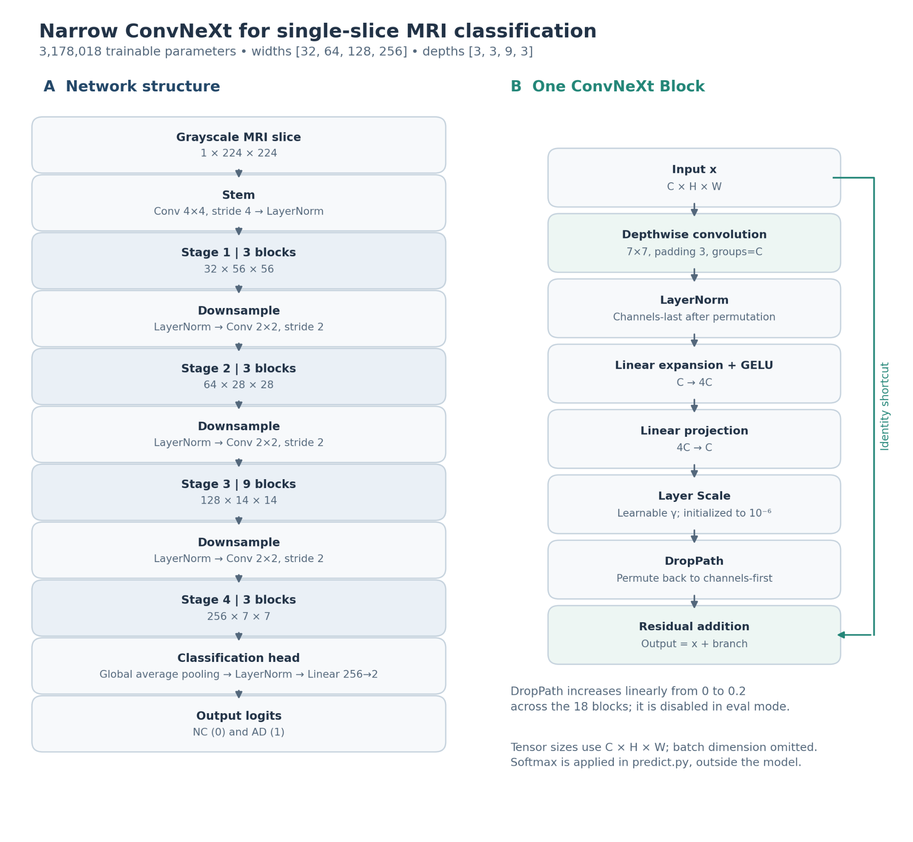
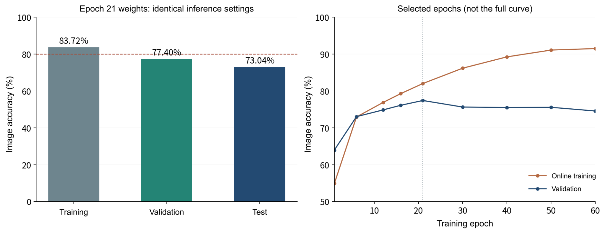
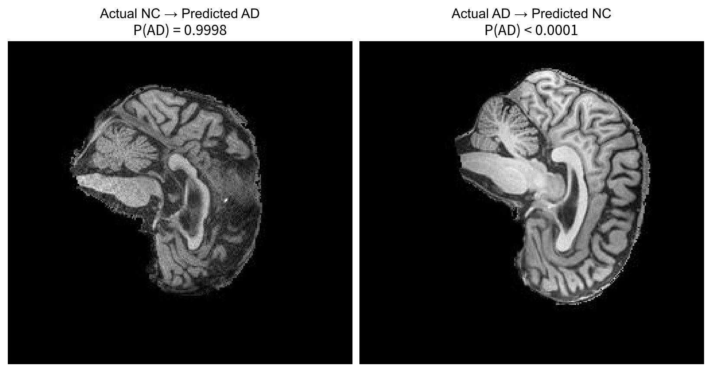
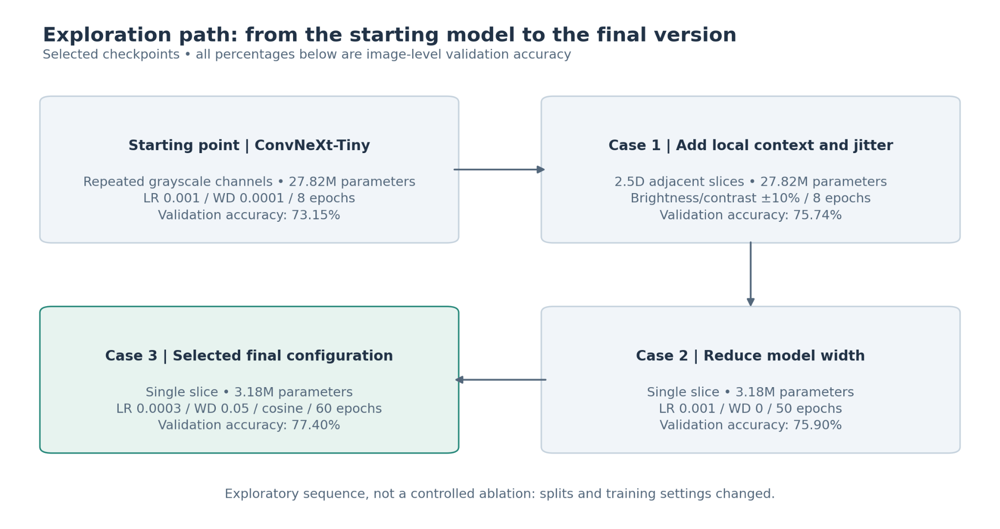

# ADNI Brain MRI Classification with Narrow ConvNeXt

Author: Jinqiao Han | 28 October 2026

## 1. Project overview and working principles

This project investigates whether the modern convolutional network ConvNeXt can distinguish Alzheimer's disease patients (AD) from normal cognitive control subjects (CN, coded as NC) using a single ADNI MRI slice.
**The final model achieved an image-level validation accuracy of 77.40%. Among the models tested in the experiment, the highest image-level test accuracy was 78.84%.** This did not meet the requirement of a 80% test accuracy.

The implemented model is a narrow ConvNeXt trained from random initialization. A grayscale slice is resized to 224 × 224 and passed through a convolutional stem and four residual stages with widths 32/64/128/256 and depths 3/3/9/3. Each block combines a 7 × 7 depthwise convolution, LayerNorm, channel expansion, GELU, channel projection, Layer Scale, and a residual connection. Global average pooling, LayerNorm, and a linear head produce two logits. Softmax is applied during inference to obtain NC and AD probabilities. The design retains the modern convolutional principles of ConvNeXt [1], with substantially fewer parameters than the original Tiny configuration.



**Figure 1. Architecture of the implemented model.** Tensor sizes exclude the batch dimension. Layer Scale starts at 10⁻⁶. DropPath increases from 0 to 0.2 across 18 blocks and is disabled during evaluation. The model contains 3,178,018 trainable parameters and uses no pretrained weights.

The report first preserves the original feasibility review and explains the subsequent changes. It then describes the data, implementation, experiments, results, error analysis, and engineering recommendation; the concise reproduction guide is in Appendix B.1. Figures for the two earlier experimental cases are collected in the appendix.

## 2. Original feasibility review and subsequent changes

### 2.1 Written feasibility review

*This is the initial version of the feasibility assessment, which is different from the actual experimental process.*

**User need, scope, and acceptance criteria.** This research prototype is intended for researchers exploring MRI-based Alzheimer's classification. It tests whether ConvNeXt, a modern convolutional neural network, can classify AD and CN images. The initial acceptance criteria were: (1) no participant overlap between the training, validation, and test sets; (2) test-set patient-level accuracy and ROC-AUC both at least 0.80; (3) reporting of both image-level and patient-level metrics; and (4) completion of an eight-epoch experiment on an A100 GPU. The prototype supports research evaluation rather than autonomous diagnosis.

**Model choice and course concepts.** The dataset contains 30,520 MRI slices from 680 participants and is split by participant. The original proposal used ImageNet-pretrained ConvNeXt-Tiny, with two epochs training the classifier head followed by six epochs of fine-tuning. The project builds on course concepts in CNNs, multilayer perceptrons, residual networks, and Transformers. ConvNeXt modernizes convolutional design while retaining residual learning; it does not use Transformer self-attention. ConvNeXt is listed in the course's Hard Difficulty band.

**Preliminary feasibility evidence.** The data audit found all 30,520 images with no missing files. A model smoke test produced the expected two-class output. Training completed on a Google Colab A100 GPU. The selected preliminary checkpoint achieved 81.16% image-level validation accuracy with validation loss 0.3890. Later training accuracy increased while validation performance declined, suggesting overfitting. Test-set results were still pending when this review was written.

**Risks, computing budget, and fallback.** The principal risks were overfitting and relying too heavily on slice-level results. Participant-level splitting and patient-level evaluation were intended to address these risks. The initial computing allocation was an eight-epoch A100 experiment; no measured wall-clock or VRAM limit was specified. The next planned experiment was evaluation on the test set, followed by learning-rate and training-setting adjustments if performance remained below target. GAN-generated training images were mentioned as an additional possibility whose usefulness still required validation, rather than an established fallback.

### 2.2 Why the implemented workflow differs from the feasibility plan

At first, I intended to use the pre-trained Tiny model, but was informed that it was not allowed. I was also advised to adopt suggestions such as "reduce the number of parameters and change the three-channel to a single-channel", so I carried out the project based on these suggestions.
After eight initial experiments, they were later expanded to 60 rounds to observe the long-term learning process, but ultimately, the 21st round was selected from the validation set. The final experiment also adopted a fixed 70%/10%/20% patient division, instead of the earlier 70%/15%/15% division.

## 3. Data, preprocessing, and final training configuration

### 3.1 Patient-level separation and split justification

The course's original train/test folders are pooled before assigning new patient-level subsets. Metadata maps numeric image filenames to scans and participants. All scans and slices belonging to one participant remain in the same subset. The code rejects conflicting patient labels and checks for patient overlap across train, validation, and test. Labels are encoded as NC=0 and AD=1.

The final split is stratified by patient class with seed 42. The reported counts are:

| Subset | Patients | Patient proportion | Scans | Images |
|---|---:|---:|---:|---:|
| Training | 476 | 70% | 1,040 | 20,800 |
| Validation | 68 | 10% | 154 | 3,080 |
| Test | 136 | 20% | 332 | 6,640 |
| Total | 680 | 100% | 1,526 | 30,520 |

The training allocation provides most participants for fitting, validation supports model selection, and the larger test allocation provides a broader final evaluation population. Patient grouping is essential because slices from the same brain are correlated. Stratification helps preserve class representation, but does not guarantee identical distributions of acquisition conditions, disease severity, or slice counts. The percentages apply to patients; image counts need not follow those percentages. The small validation population of 68 patients remains a limitation.

The saved **manifest** is a CSV containing one row per image, including `path`, `label`, `patient_id`, `scan_id`, and `split`. It records the actual assignments used by an experiment. Reuse the original manifest to reproduce the reported split. Matching the seed and proportions alone is insufficient: the current construction depends on file traversal and patient ordering, and a regenerated manifest may assign different participants even when totals agree.

### 3.2 Preprocessing and augmentation

Images are opened with Pillow, converted to grayscale, and resized to 224 × 224. `ToTensor()` maps the JPEG image intensities to [0,1], after which normalization with mean 0.5 and standard deviation 0.5 maps them approximately to [-1,1]. These fixed constants are not estimates computed from the test set. The submitted code does not perform skull stripping, registration, brain-region segmentation, or acquisition harmonization; these should not be claimed as implemented preprocessing.

Training uses random horizontal flipping with probability 0.5 and horizontal/vertical translations of at most 5%, with zero rotation. Validation and testing use deterministic resizing and normalization. The final version uses **no brightness/contrast jitter**. These are lightweight implementation choices; the anatomical suitability of flipping should be checked against the actual slice orientation. TorchVision is required to reproduce this augmentation pipeline: the minimal fallback in `dataset.py` does not apply the same training augmentation.

### 3.3 Final model and optimization settings

| Setting | Value used for the selected final version |
|---|---|
| Architecture | Narrow ConvNeXt; widths 32/64/128/256; depths 3/3/9/3 |
| Input and output | 1 × 224 × 224 image; 2 logits for NC and AD |
| Initialization | Random weights; no pretraining |
| Trainable parameters | 3,178,018 |
| Optimizer | AdamW [2] |
| Initial learning rate | 0.0003 |
| Weight decay | 0.05, applied to all trainable parameters in this code revision |
| Learning-rate schedule | `CosineAnnealingLR`, `T_max=60`; one scheduler step after each epoch; no warm-up |
| Training loss | Cross-entropy with label smoothing 0.1 |
| Maximum DropPath | 0.2, increasing linearly across the blocks |
| Training epochs and batch size | 60 epochs; batch size 64; shuffled training loader with `drop_last=True` |
| Seed and data-loader workers | 42; 4 workers |
| Mixed precision | Enabled by `--amp` on CUDA |
| EMA and jitter | Both disabled |
| Model-selection rule | Highest image-level validation balanced accuracy; a tie replaces the previous checkpoint |
| Selected historical checkpoint | Epoch 21; validation balanced accuracy 0.7762; validation accuracy 0.7740 |
| Evaluation threshold | AD when P(AD) ≥ 0.5 |

AdamW separates weight decay from the adaptive gradient update [2]. Cosine decay reduces the step size over training. Label smoothing changes a hard binary target to approximately 0.95/0.05, reducing the incentive for extreme confidence. DropPath regularizes residual branches; it is different from classifier-head Dropout. AMP primarily improves computational efficiency. None of these methods guarantees better performance on previously unseen patients.

`train.py` evaluates validation data after every epoch and saves `best_model.pth`. Test results do not determine its checkpoint selection. The checkpoint contains the selected weights, epoch, validation metrics, and command-line arguments. It does not contain the complete optimizer, scheduler, and random-number-generator states needed for exact interrupted-training resumption.

`predict.py` loads the checkpoint, uses `model.eval()`, and applies deterministic preprocessing. It reports image-, scan-, and patient-level metrics. Scan and patient predictions average slice AD probabilities directly within each group before thresholding. Patient aggregation therefore weights scans according to their slice counts; it is not a second equal-weight average over scan probabilities. The final checkpoint uses ordinary model weights. Optional EMA checkpoints are detected separately by the prediction code.

## 4. Experiments and quantitative results

### 4.1 Early experiments and the CNN baseline

The earlier ordinary CNN baseline had approximately 27.88M parameters and reached **75.88% image-level validation accuracy after eight epochs**. The final narrow ConvNeXt uses **3.18M parameters**, single-channel input, and a 60-epoch training schedule, with epoch 21 selected. Its validation accuracy of **77.40%** is numerically 1.52 percentage points higher, while its parameter count is about 88.6% lower.

These results demonstrate the increase in verification accuracy and model reduction during the exploration process. They do not prove that ConvNext outperforms other models in the same data magnitude. However, since ConvNext has fewer parameters and thus higher running efficiency, and its performance on the validation set and test set is better than that of CNN, it can be said that ConvNeXt has certain advantages.

### 4.2 Failure Case One: 2.5D Input and Brightness/Contrast Augmentation

Full ConvNeXt-Tiny used the previous, current, and next MRI slices as three input channels, with training-only brightness/contrast jitter of approximately ±10%. The aim was to add spatial context and improve intensity robustness. Training used LR=0.001, WD=0.0001, eight epochs, and a 70%/15%/15% patient split (21,700/4,320/4,500 slices); minimum validation loss selected epoch 4.

Image validation accuracy rose from 73.15% to 74.19% with 2.5D input and to **75.74%** with jitter, but image test accuracy was **72.91%**. A validation-selected patient threshold of 0.38 gave **81.37% patient test accuracy (83/102)** and AUROC=0.8555. Image/scan thresholds stayed at 0.5. The patient matrix `[[60,9],[10,23]]` shows ten missed AD patients.

Aggregation improved patient decisions without meeting the slice target. Repetitive neighboring slices and the absence of additional independent patients may explain the limited benefit. See Figure A1 in Appendix A.

### 4.3 Failure Case Two: A Narrow Single-Channel Model and 50 Training Epochs

Widths of 32/64/128/256 and one grayscale input reduced the model to **3,178,018 parameters**, mainly through narrower internal layers. With light augmentation, stochastic depth, LR=0.001, WD=0, batch size 64, and the earlier 70%/15%/15% split, training ran for 50 epochs. Minimum validation loss among checkpoints within 0.005 of peak validation image accuracy selected epoch 22.

Validation image accuracy was **75.90%**, test image accuracy **76.02%**, and patient test accuracy **80.39% (82/102)**, with AUROC=0.9007. Patient AD recall was only **63.64% (21/33)**; matrix `[[61,8],[12,21]]` records twelve missed AD patients. At epoch 50, training accuracy reached 98.12% while validation accuracy was 74.47%.

Narrowing reduced model size but did not eliminate overfitting or insufficient single-slice evidence. Figures A2–A3 show the results and two confident errors; patient-level success did not satisfy the image-level requirement.

### 4.4 Final version and selected checkpoint

The final run used the configuration in Section 3.3 and the final manifest. Epoch 21 achieved the highest validation balanced accuracy, 0.7762, corresponding to image accuracy 77.40%. Neither jitter nor EMA was enabled. A later jitter run reached 76.92% image-level validation accuracy; a separate EMA=0.999 run reached a highest logged validation balanced accuracy of 76.85%. These are different metrics and should not be compared as though both were ordinary accuracy. Neither later version was adopted.

All figures in the following table evaluate the same selected epoch-21 weights. Training-set figures are from deterministic inference with random augmentation and DropPath disabled; they are not online accuracy from the final training epoch.

| Metric | Training images | Validation images | Test images |
|---|---:|---:|---:|
| Accuracy | 83.72% | **77.40%** | **73.04%** |
| Balanced accuracy | 83.80% | 77.62% | 73.14% |
| AD recall | 87.67% | 80.42% | 77.28% |
| Macro-F1 | 0.8371 | 0.7738 | 0.7303 |
| ROC-AUC | 0.9243 | 0.8337 | 0.8153 |

The final test-image confusion matrix is `[[2346, 1054], [736, 2504]]`. The following per-class measures are calculated directly from those counts:

| Test-image measure | NC | AD |
|---|---:|---:|
| Precision | 76.12% | 70.38% |
| Recall | 69.00% | 77.28% |

AD F1 is 0.7367. In total, 1,054 NC slices were classified as AD and 736 AD slices as NC. Validation scan- and patient-level accuracies were 80.52% and 73.53%; the corresponding test results were 74.10% and 72.79%.



**Figure 2. Final-model results.** Left: deterministic inference on all three subsets using epoch-21 weights. Right: recorded accuracies at epochs 1, 6, 12, 16, 21, 30, 40, 50, and 60; this is not a complete epoch-by-epoch curve. Online training accuracy increased from 82.00% at epoch 21 to 91.48% at epoch 60, while validation accuracy decreased from 77.40% to 74.55%.

### 4.5 Resource profiling

| Model and evaluation | Parameters | GPU | Peak allocated evaluation VRAM | Inference time per image |
|---|---:|---|---:|---:|
| Final narrow ConvNeXt, reported test run | 3,178,018 | A100-SXM4-40GB | 599.9 MiB | Approximately 0.59 ms |


## 5. Confidence, ambiguity, and individual error analysis

Accuracy and AUROC do not establish calibrated confidence. The two documented errors below come from **Case Two**, not the selected final checkpoint.

### 5.1 False positive with extreme AD confidence

- **Evidence:** NC patient `023_S_1190`, slice `1251421_104.jpeg`, predicted AD with P(AD)=0.9998 (Figure A3).
- **Possible failure mode:** patient-specific appearance or weak diagnostic content in the slice. Check neighboring slices, orientation, and intensity; the anatomical cause is unverified.

### 5.2 False negative with extreme NC confidence

- **Evidence:** AD patient `127_S_5028`, slice `375181_98.jpeg`, predicted NC with P(AD)<0.0001 (Figure A3).
- **Possible failure mode:** limited slice evidence for a patient-level label. Check label mapping and adjacent-slice probabilities. A slice error does not prove an incorrect aggregated patient prediction.

### 5.3 Proposed referral rule and validation procedure

- A future rule could refer predictions with `max(P(AD), 1-P(AD)) < tau` for human review. Choose `tau` on validation data by comparing retained accuracy, coverage, and missed AD cases; freeze it before testing.
- This rule is **not implemented or validated**. Both examples would evade a simple low-confidence filter. Reliability diagrams or Brier scores could assess calibration; the patient class threshold of 0.38 is not a referral threshold.

## 6. Future plan and final conclusion

### 6.1 Interpretation and practical trade-offs

Augmentation adds variation, not independent patients; shrinking the network reduces parameters but does not guarantee generalization. The small validation population and possible acquisition differences remain limitations. Further work should prioritize a same-split CNN comparison, verified error analysis, and patient/scan-balanced sampling or foreground intensity normalization over simply extending training. Repeated exploratory use of test results also limits the strength of final generalization claims.

For the project manager, retain narrow ConvNeXt as a compact research prototype with human review. Its measured inference cost is modest on the A100, but a matched baseline profile is needed to justify the accuracy–resource trade-off.

### 6.2 Conclusion for the selected final version

The selected epoch-21 narrow ConvNeXt achieved **77.40% image validation accuracy and 73.04% image test accuracy**, with test macro-F1=0.7303 and ROC-AUC=0.8153. Its 3,178,018 parameters substantially reduce model size, but test accuracy remains **6.96 percentage points below the 80% requirement**.

Verification accuracy is numerically higher than the early CNN's 75.88%. This project has established a complete zero-training classification process and discovered persistent generalization and confidence limitations. The early patient-level exceeding 80% is a useful supplementary result, which can indirectly indicate that ConvNeXt has certain advantages.

## Artificial Intelligence Usage Disclosure

ChatGPT was used for code suggestions, debugging, organizing experimental ideas, and assistance with report writing and figure layout. Experimental results come from actual run records; optimizations not yet implemented are presented as suggestions.

## References

1. Liu, Z., Mao, H., Wu, C.-Y., Feichtenhofer, C., Darrell, T., and Xie, S. **A ConvNet for the 2020s.** CVPR, 2022. [Paper](https://arxiv.org/abs/2201.03545).
2. Loshchilov, I., and Hutter, F. **Decoupled Weight Decay Regularization.** ICLR, 2019. [Paper](https://arxiv.org/abs/1711.05101).
3. PyTorch. **Reproducibility.** [Documentation](https://docs.pytorch.org/docs/stable/notes/randomness.html).
4. GitHub. **About the repository README file.** [Documentation](https://docs.github.com/en/repositories/managing-your-repositorys-settings-and-features/customizing-your-repository/about-readmes).

Experimental sources: the project's recorded training and evaluation results, the original *Feasibility of ConvNeXt* review, the supplied README and figures, and the inspected `modules.py`, `dataset.py`, `train.py`, and `predict.py`. Earlier and final results are distinguished by model version, dataset subset, and evaluation level.

## Appendix A. Figures for the earlier experiments

### Figure A1. Case One test results


The left panel shows accuracies from the same test evaluation: 72.91% at image level, 76.44% at scan level, and 81.37% at patient level. The dashed line marks 80%. Image and scan thresholds are 0.5; the patient threshold is 0.38, selected on validation data. The right panel contains 102 patients, with actual NC/AD as rows and predicted NC/AD as columns. Ten of 33 AD patients were missed.

### Figure A2. Case Two test results


All three levels use threshold 0.5. Accuracies are 76.02% for images, 80.44% for scans, and 80.39% for patients. The patient matrix contains 61 correctly classified NC patients and 21 correctly classified AD patients; twelve AD patients were missed. The class counts are 69 NC and 33 AD, so overall accuracy should be read alongside AD recall.

### Figure A3. Two high-confidence errors from Case Two



Left: `023_S_1190`, `1251421_104.jpeg`, actual NC, predicted AD, P(AD)=0.9998. Right: `127_S_5028`, `375181_98.jpeg`, actual AD, predicted NC, P(AD)<0.0001. The original MRI display and probabilities are retained. These are slice-level errors from the earlier model, and do not establish that either patient's aggregate prediction was wrong.

## Appendix B. Experimental path



**Figure B1. Main exploration sequence.** Percentages are image-level validation accuracies of selected checkpoints. Arrows describe development order, not controlled causal effects. Cases One and Two use the earlier split, while the final version uses 70%/10%/20%.

### B.1 Getting started and reproducing the workflow

#### B.1.1 Files and external experiment artifacts

`modules.py` defines the network; `dataset.py` loads and preprocesses patient-grouped data; `train.py` trains and selects weights; `predict.py` evaluates saved weights. Obtain ADNI through the course source. Historical evaluation also requires the original epoch-21 checkpoint and matching manifest, supplied separately. Keep `images/` beside this README for local figure display; repository assets must follow the course's file restrictions.

#### B.1.2 Dependencies and environment recording

Required: Python, PyTorch, TorchVision, NumPy, pandas, Pillow and scikit-learn. For the plotting in Appendix C, Matplotlib is also needed.

#### B.1.3 Obtain the code and set paths

Download the four scripts, open the terminal in their directory, and replace the placeholder paths in the commands with the data root directory, the original manifest, and a new output directory. This project was carried out using Google Colab. If you also want to use Google Colab, you should first mount Drive in Colab and then use the corresponding path. The data root directory contains AD_NC/ and metadata JSON, and the actual division is determined by the manifest. Record the used code commit.

```bash
export ADNI_DATA_ROOT=/home/groups/comp3710/ADNI
export ADNI_MANIFEST=/absolute/path/to/original/manifest.csv
export ADNI_RUN_DIR=/absolute/path/to/new_run
```

The data root contains `AD_NC/` and `meta_data_with_label.json`. The manifest, rather than the original folder names, determines the split. Record the code commit used.

#### B.1.4 Audit the original manifest and run a model smoke test

Run `python modules.py`: expect 3,178,018 parameters and output shape `(2, 2)`. Check the split counts against Section 3.1 and confirm no patient overlap. Reuse the original manifest; generating another one does not reproduce the historical evaluation.

#### B.1.5 Train the final configuration

```bash
python train.py --data_root "$ADNI_DATA_ROOT" --manifest "$ADNI_MANIFEST" \
  --out_dir "$ADNI_RUN_DIR" --epochs 60 --batch_size 64 --lr 3e-4 \
  --weight_decay 0.05 --base_channels 32 --drop_path_rate 0.2 --jitter 0 --seed 42 --amp
```

Leave EMA disabled. The script saves `train_log.txt`, `manifest.csv`, and `best_model.pth`. Seed 42 does not guarantee identical GPU reruns; retain the manifest and environment [3]. The logged LR is for the next epoch, and no validation loss is logged.

#### B.1.6 Evaluate the selected checkpoint

```bash
export ADNI_CHECKPOINT="$ADNI_RUN_DIR/best_model.pth"
python predict.py --checkpoint "$ADNI_CHECKPOINT" --manifest "$ADNI_MANIFEST" \
  --data_root "$ADNI_DATA_ROOT" --split val --out_dir "$ADNI_RUN_DIR/eval_val"
python predict.py --checkpoint "$ADNI_CHECKPOINT" --manifest "$ADNI_MANIFEST" \
  --data_root "$ADNI_DATA_ROOT" --split test --out_dir "$ADNI_RUN_DIR/eval_test"
```

Use the historical checkpoint for historical evaluation, or label newly trained weights as a new experiment. Keep separate output folders. The input is a grayscale MRI slice from the chosen manifest subset; outputs include AD probabilities in `predictions_<split>.csv`, plus `eval_report.txt` and `.json`. The CLI evaluates subsets, not an arbitrary `--image`. Recorded final test output: **6,640 images, accuracy 0.7304, balanced accuracy 0.7314, ROC-AUC 0.8153**, confusion matrix `[[2346,1054],[736,2504]]`.

## Appendix C. Plotting the recorded training log

**Purpose and necessity:** This optional recipe reads `train_log.txt` and saves `training_curves.png`, plotting training loss and training/validation accuracy. It does not train the model or alter checkpoint selection. It is not required to reproduce predictions or satisfy the task sheet's visual-plot requirement when the existing figures are provided; retain it only as a convenience for plotting a new run. No validation-loss curve is available because this code does not log validation loss. Set `ADNI_RUN_DIR` using Appendix B.1 first.

```bash
python - <<'PY'
import os
import re
from pathlib import Path
import matplotlib
matplotlib.use("Agg")
import matplotlib.pyplot as plt

run = Path(os.environ["ADNI_RUN_DIR"])
pattern = re.compile(
    r"epoch\s+(\d+)/\d+\s+\| loss ([\d.]+)\s+\| "
    r"train_acc ([\d.]+)\s+\| val_acc ([\d.]+)\s+\| val_bal_acc ([\d.]+)"
)
rows = [tuple(map(float, match.groups()))
        for match in pattern.finditer((run / "train_log.txt").read_text())]
if not rows:
    raise RuntimeError("No matching training records found.")
epochs, losses, train_acc, val_acc, val_bal = zip(*rows)
if len(set(epochs)) != len(epochs):
    raise RuntimeError("Repeated epochs detected: separate appended runs before plotting.")
fig, axes = plt.subplots(1, 2, figsize=(11, 4))
axes[0].plot(epochs, losses, label="Training loss (label smoothing 0.1)")
axes[0].set(xlabel="Epoch", ylabel="Loss")
axes[1].plot(epochs, train_acc, label="Online training accuracy")
axes[1].plot(epochs, val_acc, label="Validation accuracy")
axes[1].plot(epochs, val_bal, label="Validation balanced accuracy")
axes[1].set(xlabel="Epoch", ylabel="Score", ylim=(0, 1))
for ax in axes:
    ax.legend()
    ax.grid(alpha=0.2)
fig.tight_layout()
fig.savefig(run / "training_curves.png", dpi=200)
plt.close(fig)
print(run / "training_curves.png")
PY
```
